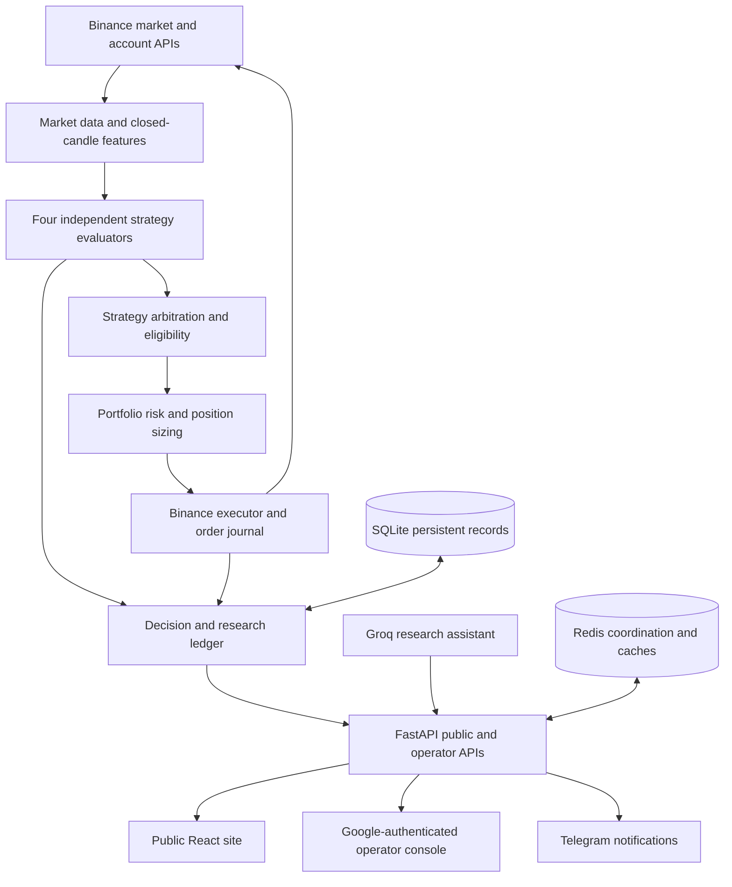

# Architecture

Signal Engine is one Python trading service and two deployable React interfaces. The core design separates **market observations**, **strategy proposals**, **portfolio decisions**, and **exchange orders**. Research reuses strategy evaluation rather than maintaining a different rule set.

## System context

The diagram shows logical relationships, not proof that any exchange is reachable or that a strategy is profitable. AI chat does not place exchange orders.

## Runtime boundaries

| Concern | Source ownership | Notes |
| --- | --- | --- |
| Startup, auth boundary, HTTP middleware | `main.py`, `operator_auth.py`, `access/`, `portal_settings.py` | Separate public and admin request paths; production reverse proxy requires trusted headers. |
| Fetching and scan scheduling | `data/`, `alerts/scanner.py`, `scheduler.py` | Scans the configured universe under bounded concurrency; records failed evaluations separately. |
| Strategy evaluation | `strategies/registry.py` | One deterministic, closed-candle implementation per strategy; shared with backtesting. |
| Selection and sizing | `strategies/pipeline.py`, `engines/`, `strategies/control.py` | Filters strategy proposals, prevents conflicting symbol positions, applies grade and sizing rules. |
| Execution and reconciliation | `trade/`, `runtime_state.py` | Existing Binance order path, journal, account mode and protective-order handling. |
| Storage and research | `database.py`, `research/`, `backtest/` | SQLite signal/trade evidence, experiments, histories and reproducible replay. |
| HTTP surface | `api/`, `main.py` | `/api/v1/public/` for public projections; operator APIs require authenticated admin boundary. |
| React interfaces | `dashboard/src/`, `dashboard/functions/` | Separate public/admin builds and optional Cloudflare Pages proxy functions. |
| Observability | `ops/host_telemetry.py`, `api/engine_health.py` | Best-effort system telemetry; absent Docker/EC2 permissions are reported as unavailable. |

## Trading decision lifecycle

1. Scanner obtains closed candles and validates indicator readiness.
2. Each scanning-enabled strategy evaluates the same feature set independently and emits either a structured rejection with checks or a proposed entry, stop and target.
3. Eligible proposals are arbitrated for the symbol. Conflicting long/short proposals are rejected; at most one proposal per symbol continues.
4. Strategy permissions, grade, per-coin minimum reward-to-risk, exposure, account equity, session and other risk rules must allow execution.
5. The existing executor handles order intents, exchange requests and reconciliation in the account's selected mode. Failed or uncertain execution cannot be assumed filled.
6. Signals, decision checks, orders and market observations are persisted for the operator; stale actionable signals expire without erasing the audit history.

The same strategy evaluator is used for research replay. Replay differs from real fills, slippage, funding, latency, margin, live position accounting and exchange state; it is not an equivalence guarantee.

## Persistence and upgrade rules

`database/` is the persistent application directory, including SQLite, runtime state and optional RAG data. Redis has its own Compose volume. Do not replace these while copying a source ZIP. Schema changes should be forward-compatible with existing installations and tested on a copy of the previous database. Preserve the active execution mode; it is not reset by an upgrade.

## Failure handling

- Unknown/missing market data: classify as insufficient or failed data, never manufacture a signal.
- Opposing strategy proposals: reject both from execution for that symbol.
- Missing/stale account equity or unreconciled orders: fail closed for new execution.
- Infrastructure telemetry unavailable: show unavailable; never infer a Docker or EC2 value.
- Groq unavailable: research assistant should report an error or alternate configured supported model, never treat AI output as a trading decision.

See [Operations](OPERATIONS.md), [Strategies](STRATEGIES.md), and [Research](RESEARCH.md) for operational and evidence gates.
