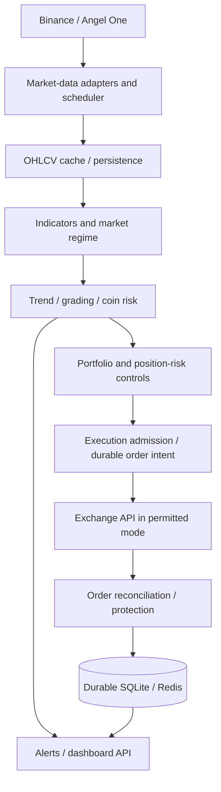

# Architecture and decision paths

## System boundaries

## Active crypto signal path

- `scheduler.py`, `agents/signal_agent.py`: scheduled scanning and main decision path.
- `engines/core/indicators.py`: EMA, RSI, ADX, ATR, volume ratio and price structure on **closed** candles.
- `engines/regime/detector.py`, `engines/trend/direction.py`: market-regime and coin-specific ADX/trend gating.
- `engines/scoring/scorer.py`: a single score/grade calculation consumed by live signals and research.
- `engines/risk/calculator.py`, `engines/sizing/adaptive.py`: ATR/swing stop, coin target multiple, budget and hard portfolio limits.
- `engines/core/sessions.py`: canonical UTC session policy, now shared with the backtester and live code.
- `trade/executor.py`, `trade/order_journal.py`, `trade/exchange.py`: broker calls, durable intent reservations, exchange-spec enforcement; uncertain fills need human reconciliation.
- `data/`, `database.py`, `redis_client.py`: persistence/caching. SQLite is not a horizontally scalable multi-writer deployment architecture.

`engines/crypto/strategy.py` is a **legacy alternate prototype** with its own scoring rules. No reference from the current main signal or scan entry points was identified during this audit. It remains for compatibility; it must not be used as a second source of live truth or taken as proof of backtest parity. Decide to retire or migrate it after call-site/integration verification.

## Research path

`backtest/research.py` obtains OHLCV/funding and verifies dataset manifests; `backtest/engine.py` replays the main signal ingredients; `backtest/per_coin_audit.py` compares existing coin settings with predeclared variants; `backtest/walkforward.py` selects on training folds and reports untouched chronological holdouts. A backtest is **not** an exact broker simulator: resting-order fill priority, exchange interruptions and variable transaction costs remain approximations.

## Indian-market path

`engines/indian/` handles Angel One authentication, cached candle/price requests, an opening-range strategy, and signal/notification workflows. Client-code-scoped Redis quota gates coordinate requests across workers. A successful quota admission is not a substitute for real Redis or broker integration tests.

## Frontend and API boundary

React/Vite source is in this monorepo's `dashboard/` directory. Cloudflare Pages serves the entire browser application at `app.vishalkool.top`; AWS no longer serves the compiled frontend. The AWS service at `signal-engine-v5.vishalkool.top` retains OAuth, authenticated `/api/*` routes, `/ws/dashboard`, webhooks and all market/broker workloads.

Cloudflare builds from `dashboard/` into `dist/`. Login callbacks originate on AWS but finish on the configured `FRONTEND_URL` to return to Cloudflare. `GET /api/health` remains public liveness; `GET /api/system/health` is administrator-only, reports live Redis connectivity, and is independent of the browser network's status. The dashboard retrieves tier entitlements from `/api/pricing` rather than duplicating the Python rules.

## Safety invariants

1. Live trading defaults off; no automated enabling from tests, config optimization or UI actions.
2. Unknown exchange position or database risk state means **no new exposure**.
3. An ambiguous network response must **not** become an automatic duplicate order.
4. Protective stops and position size are checked against the **actual** exchange exposure.
5. Historical tuning never mutates live per-coin configuration automatically.
6. Invalid/nonfinite market data and wrong-side stops must be rejected before order creation.

See [Research](RESEARCH.md), [Operations](OPERATIONS.md), and [release evidence](engineering/RELEASE_EVIDENCE.md).

## Maintainer decisions

- Keep a single GitHub monorepo, but do not rename the existing AWS Python entrypoints or Compose services.
- Cloudflare Pages serves browser HTML/assets; AWS remains the only scheduler, OAuth callback host, API and broker executor.
- Treat ambiguous exchange submissions as reconciliation-required instead of repeating orders; trade protection has its own operational checks.
- Preserve UTC session definitions, score/grade calculations and original configured coin behavior until audited research supports changes.
- Separate signal visibility tiers from trading-execution permissions; plan levels do not authorize live orders.
- Use Resend for account setup/security email only. Retain Telegram for trading alerts.
- No GitHub Actions; Cloudflare's native Git integration deploys the dashboard.
